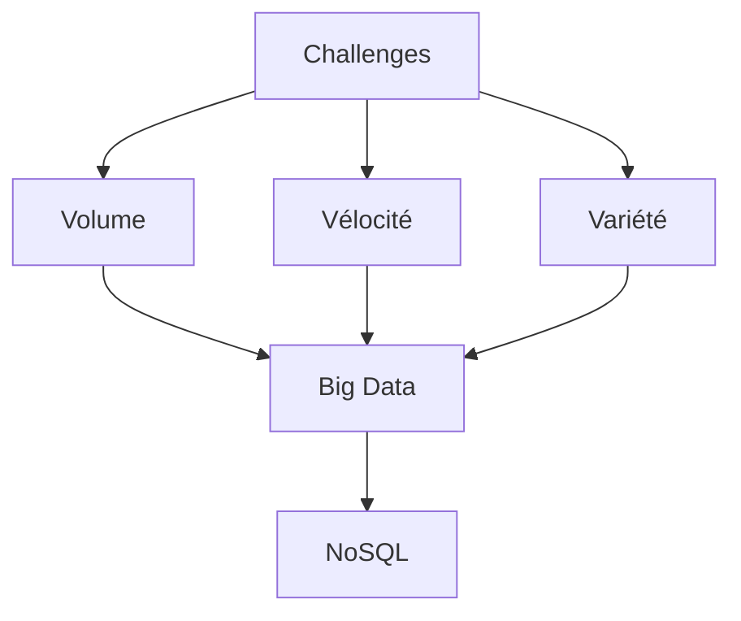
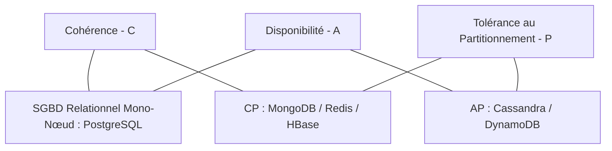
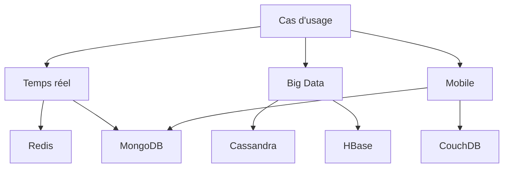
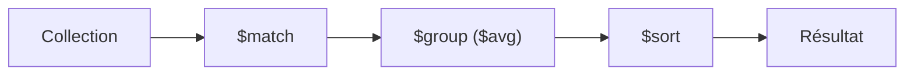
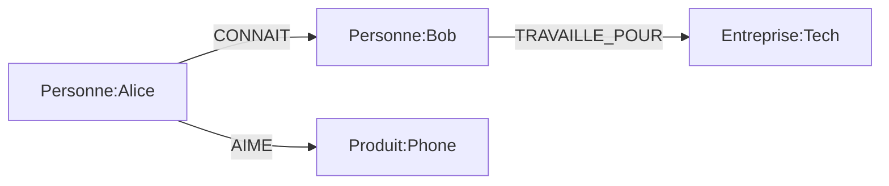
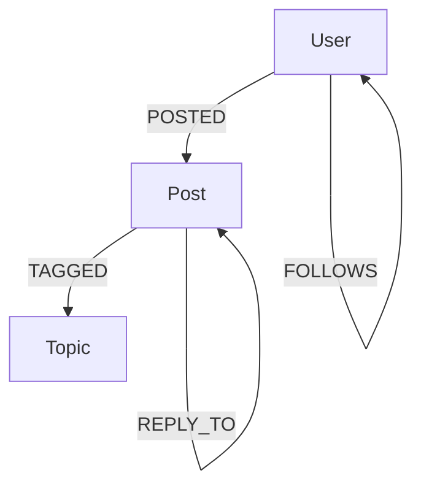
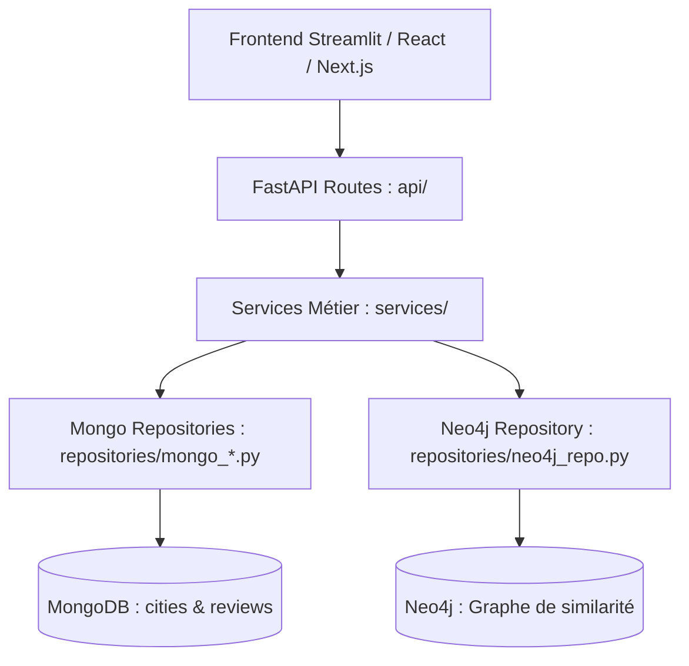

# Bases de données NoSQL


---
layout: two-cols-header
---


# Qui suis-je?

- 🧑🏾 **Nom**: Brice FOTZO
- 🌍 **Origine**: Bafoussam, Cameroun
- 🎓 **Formation**: Ingénieur Généraliste(BDTN) - ESIGELEC Rouen

> Parcours Data & AI
- Analytics Engineer - **Apprenti** @ Renault
- Data Engineer - CDI @ Starclay
- Tech Lead Data - CDI @ HephIA
- Tech Lead Data - CDI @ Servier
- Intervenant - CDD @ ESIGELEC Rouen/Poitiers

> Engagements Communautaires
- Data Engineer - **Volunteer** @ Validalab(DFG)
- MUG Leader Paris - **Volunteer** @ MongoDB
- Créateur de contenu @ LinkedIn, Medium
- Créateur de Serial Techos

---
layout: default
---

# Et vous?
## Faisons connaissance
<div class="mr-4 mt-6">
  
</div>
---
layout: two-cols-header
---

# Plan du module

::left::
- **1. Introduction au NoSQL**
  - Pourquoi NoSQL & Théorème CAP
  - Les 4 familles NoSQL & cas d'usage
  - Comparaison SQL vs NoSQL

- **2. MongoDB (Orienté Document)**
  - Modèle BSON, CRUD & Opérateurs
  - Pipeline d'Agrégation (`$match`, `$group`, `$avg`)
  - Modélisation : *Embedding* vs *Referencing*
  - Nouveautés : **MongoDB 8.2+, Voyage AI, Reranking & MCP**

::right::

- **3. Neo4j (Orienté Graphe)**
  - Property Graph Model (Nœuds, Relations, Propriétés)
  - Langage Cypher (`MATCH`, `MERGE`, `collect()`, chemins)
  - Nouveautés : **GraphRAG, Index Vectoriel HNSW & Cypher 25**

- **4. Architecture Polyglotte & Projets**
  - Projet guidé : **SmartCity Explorer** (FastAPI + Mongo + Neo4j)
  - Projet final : **Portfolio d'Ingénieur Polyglotte**

---
layout: two-cols-header
---

# Organisation du module (3 Jours)

::left::
**Jour 1 (Lun 09/11 : 9h-12h & 13h30-17h30)**
  - **09h00 – 11h00 (2h CM)** : Panorama NoSQL, MongoDB & Neo4j
  - **11h00 – 12h00 (1h TP)** : Enrôlement GitHub & Setup Docker `SmartCity`
  - **13h30 – 17h30 (4h TP)** : Design & Sprints `SmartCity` *(Neo4j Browser & OneCompiler en sandbox)*
  - **Intersession J1 -> J2** : Finir les 4 Sprints `SmartCity` (`200/200`)

::right::

**Jour 2 (Lun 16/11 : 9h-12h & 14h-17h — 100% TP)**
  - **09h00 – 12h00** : System Design `Portfolio` (`ARCHITECTURE.md` & `API_ROUTES.md`)
  - **14h00 – 15h30** : **Soutenances System Design** (Jalon 1 — 30%)
  - **15h30 – 17h00** : Dev Backend d'équipe & Frontends individuels

**Jour 3 (Ven 20/11 : 9h-12h & 14h-17h — 100% TP)**
  - **09h00 – 12h00** : Intégration finale Backend + 4 Frontends personnels
  - **14h00 – 17h00** : **Démonstrations Live** des Portfolios (Jalon 2 — 70%)

---
layout: two-cols-header
---

# Objectifs d'apprentissage

::left::

- **Compétences visées** :
   - Arbitrer entre **SQL**, **Document (MongoDB)** et **Graphe (Neo4j)**
   - Modéliser en NoSQL (*Embedding* vs *Referencing*, Graphe de propriétés)
   - Écrire des pipelines d'agrégation MQL et des traversées Cypher
   - Concevoir une **Architecture Polyglotte** industrielle en Python
   - Comprendre les usages IA modernes (**Vector Search, Voyage AI, MCP, GraphRAG**)

::right::
- **Stack technique du module** :
   - Bases NoSQL : `MongoDB 7/8`, `Neo4j 5`
   - Backend & API : `Python 3.11+`, `FastAPI`, `Pydantic`
   - Drivers Async : `Motor / PyMongo`, `Neo4j Python Driver`
   - Outillage & CI : `Docker Compose`, `uv`, `pytest`, `GitHub Actions`


---
layout: cover
---

# Introduction au NoSQL
## Au-delà du relationnel

---
layout: two-cols-header
---

# Qu'est-ce que le NoSQL ?

::left::

<div class="mb-6">

### Origine
**11 juin 2009** à San Francisco
- Meetup organisé par Johan Oskarsson
- Émergence d'un nouveau paradigme

</div>

<div>

### Définitions
- **No SQL** : N'utilisent pas un modèle relationnel (ni le langage SQL)
- **Not only SQL** : Bases non relationnelles complémentaires

</div>

::right::

<div>

### Caractéristiques principales
- ✅ Open source
- ✅ Conçus pour des clusters puissants
- ✅ Basés sur les besoins du web au 21ème siècle
- ✅ Pas de schéma fixe
- ✅ Permet l'ajout de champs sans contrôles

</div>

---
layout: default
---

# Évolution historique

<div class="grid grid-cols-3 gap-4">

<div>

### 1970-2000
**Ère des SGBD traditionnels**
- Domination des bases relationnelles
- SQL comme standard
- Oracle, MySQL, PostgreSQL

</div>

<div>

### 2000-2010
**Émergence du NoSQL**
- Bulle internet
- Papiers de recherche (Google, Facebook, IBM)
- BDD open source (MongoDB, CouchDB, Neo4j, Redis, Cassandra, HBase, Riak)

</div>

<div>

### 2010-Aujourd'hui
**Ère du Cloud DBaaS**
- MongoDB Atlas
- AWS DynamoDB
- Google Cloud Firestore
- Azure Cosmos DB
- Cloudant

</div>

</div>

---
layout: two-cols-header
---

# Pourquoi NoSQL ?

::left::

<div class="mb-6">

### Limites du SQL
- Schéma rigide
- Scalabilité verticale
- Performances avec grands volumes
- Structures complexes
- Coût des jointures

</div>

<div>

### Besoins modernes
- Données non structurées
- Scalabilité horizontale
- Haute disponibilité
- Temps réel
- Agilité de développement

</div>

::right::



---
layout: default
---

# Le théorème CAP

<div class="grid grid-cols-3 gap-4">

<div>

### Cohérence
- Tous les nœuds voient les mêmes données
- Lectures cohérentes
- Transactions ACID

</div>

<div>

### Disponibilité
- Chaque requête reçoit une réponse
- Sans erreur
- Sans garantie de fraîcheur

</div>

<div>

### Tolérance au partitionnement
- Le système continue de fonctionner
- Malgré les pertes de messages
- Ou pannes réseau

</div>

</div>

<div class="mt-8">



</div>

---
layout: two-cols-header
---

# Types de bases NoSQL

::left::

<div class="mb-6">

### Document (MongoDB)
```json
{
  "id": 1,
  "nom": "Dupont",
  "adresses": [
    {
      "type": "domicile",
      "ville": "Paris"
    },
    {
      "type": "travail",
      "ville": "Lyon"
    }
  ]
}
```

</div>

<div>

### Clé-valeur (Redis)
```bash
SET user:1:nom "Dupont"
SET user:1:email "dupont@mail.com"
HSET user:1 nom "Dupont" email "dupont@mail.com"
```

</div>

::right::

<div class="mb-6">

### Colonnes (Cassandra)
```sql
CREATE TABLE users (
  user_id uuid,
  year int,
  month int,
  events map<timestamp, text>,
  PRIMARY KEY ((user_id), year, month)
);
```

</div>

<div>

### Graphe (Neo4j)
```cypher
CREATE (u:User {name: 'Dupont'})
CREATE (p:Post {title: 'NoSQL'})
CREATE (u)-[:AUTHORED]->(p)
```

</div>

---
layout: two-cols-header
---

# Caractéristiques des BDD NoSQL

::left::

<div class="mb-4">

### 🌐 Communautés impliquées et actives
- Proviennent de l'Open Source ou ont une version Open Source
- Support des communautés fondamental pour la croissance
- **Exemples** :
  - MongoDB : 858 contributeurs
  - Cassandra : 472 contributeurs
  - Redis : 775 contributeurs

</div>

<div class="mb-4">

### 📊 Passage à l'échelle (Scalabilité)

**Scalabilité Horizontale** ✅
- Ajout de serveurs de même capacité
- Ex: 8 serveurs 2vCPUs/4Go
- Approche privilégiée par NoSQL

**Scalabilité Verticale** ❌
- Augmentation de la puissance d'un serveur
- Plus coûteuse et limitée

</div>

::right::

<div class="mb-4">

### ✅ Disponibilité garantie
- Serveur unique : Point de défaillance unique
- Cluster de serveurs : Réplication des données
- Haute disponibilité native

</div>

<div class="mb-4">

### ☁️ Cloud Ready et coûts réduits
- Architectures Cloud natives
- Paradigme Cloud intégré
- Serveurs standards, open source
- Implémentation peu coûteuse

**Exemple de coût** :
- MongoDB Community Edition : **0$**
- Oracle RAC : **$47,500** par unité

</div>

<div class="mb-4">

### ⚡ Hautes performances
- ⏱️ Réponse rapide
- 👥 Haute concurrence
- Nombreux utilisateurs simultanés

</div>

<div>

### 🔄 Flexibilité
- Schéma flexible : Modification à la volée
- Types de données variés
- Indexage spécifique
- Dénormalisation acceptée

</div>


---
layout: default
---

# Comparaison SQL vs NoSQL

<div class="grid grid-cols-2 gap-4">

<div>

### SQL
- Schéma fixe
- Relations
- Transactions ACID
- Jointures
- Scalabilité verticale
- Requêtes complexes
- Cohérence forte

</div>

<div>

### NoSQL
- Schéma flexible
- Documents imbriqués
- BASE (Basic Availability)
- Dénormalisation
- Scalabilité horizontale
- Requêtes simples
- Cohérence éventuelle

</div>

</div>

<div class="mt-6">

### Critères de choix
1. Nature des données (structurées vs non structurées)
2. Volume et croissance prévue
3. Patterns d'accès (lectures vs écritures)
4. Besoins en cohérence
5. Expertise de l'équipe

</div>

---
layout: two-cols-header
---

# Cas d'usage

::left::

<div class="mb-4">

### Applications idéales
- Réseaux sociaux
- IoT / Big Data
- Logging
- E-commerce
- Temps réel
- Contenu mobile

</div>

<div>

### Exemples concrets
- Facebook : Cassandra
- LinkedIn : MongoDB
- Twitter : Redis
- Amazon : DynamoDB

</div>

::right::



---
layout: default
---

# Testons nous un peu
## Connectez-vous à ce wooclap
<div class="mr-4 mt-6">
  
</div>

---
layout: cover
---

# MongoDB
## Une base de données orientée document

---
layout: default
---

# Qu'est-ce que MongoDB ?

### Caractéristiques principales
- Base de données NoSQL orientée document
- Documents au format BSON (Binary JSON)
- Schéma flexible et dynamique
- Scalabilité horizontale native
- Haute disponibilité avec la réplication

### Architecture
- Collections ≈ Tables en SQL
- Documents ≈ Lignes en SQL
- Champs ≈ Colonnes en SQL
- Index supportés
- Pas de jointures natives

---
layout: two-cols-header
---

# Structure des données

::left::

### Document BSON
```json
{
  "_id": ObjectId("5f7d3"),
  "nom": "Dupont",
  "age": 30,
  "adresses": [
    {
      "type": "domicile",
      "ville": "Paris",
      "code_postal": "75001"
    },
    {
      "type": "travail",
      "ville": "Lyon",
      "code_postal": "69001"
    }
  ],
  "tags": ["VIP", "Premium"]
}
```

::right::

### Types de données
- Strings
- Numbers (Integer, Float, Decimal)
- Dates
- Boolean
- Arrays
- Embedded Documents
- ObjectId
- Null
- Binary Data
- Regular Expression

---
layout: two-cols-header
---

# Opérations CRUD

::left::

### Create
```javascript
// Insérer un document
db.clients.insertOne({
  nom: "Dupont",
  age: 30
})

// Insérer plusieurs documents
db.clients.insertMany([
  { nom: "Martin", age: 25 },
  { nom: "Bernard", age: 35 }
])
```

### Read
```javascript
// Trouver tous les clients
db.clients.find()

// Avec filtre
db.clients.find({
  age: { $gt: 30 }
})
```

::right::

### Update
```javascript
// Modifier un document
db.clients.updateOne(
  { nom: "Dupont" },
  { $set: { age: 31 } }
)

// Modifier plusieurs documents
db.clients.updateMany(
  { age: { $lt: 30 } },
  { $set: { statut: "jeune" } }
)
```

### Delete
```javascript
// Supprimer un document
db.clients.deleteOne({
  nom: "Dupont"
})

// Supprimer plusieurs documents
db.clients.deleteMany({
  age: { $lt: 25 }
})
```

---
layout: default
---

# Requêtes avancées & Mises à jour riches

::left::

### Opérateurs de comparaison & regex
```javascript
db.cities.find({
  population: { $gte: 100000 },       // >= 100 000
  region: { $in: ["Normandie", "Bretagne"] },
  name: { $regex: "^rou", $options: "i" } // insensible à la casse
}).sort({ overall_score: -1 }).skip(0).limit(20)
```

::right::

### Opérateurs logiques & tableaux
```javascript
// Mise à jour atomique ($set, $inc, $push)
db.cities.updateOne(
  { id: 1 },
  {
    $set: { region: "Normandie" },
    $inc: { population: 500 },
    $push: { scores: { category: "sport", score: 8.5 } }
  }
)
```

---
layout: two-cols-header
---

# Pipeline d'Agrégation MongoDB (`aggregate`)

::left::

### Principe : traiter les documents par étapes (*stages*)
1. **`$match`** : Filtrer les documents en entrée *(utilise les index !)*
2. **`$group`** : Regrouper et calculer (`$avg`, `$sum`, `$min`, `$max`)
3. **`$sort` / `$limit`** : Trier et limiter les résultats
4. **`$project`** : Formater les champs en sortie



::right::

### Exemple concret (utilisé dans `SmartCity`)
Calculer la note moyenne et le nombre d'avis par ville :

```python
pipeline = [
    # 1. Filtrer les avis d'une ville
    {"$match": {"city_id": city_id}},
    # 2. Calculer la moyenne des notes
    {
        "$group": {
            "_id": "$city_id",
            "avg_rating": {"$avg": "$rating"},
            "total_reviews": {"$sum": 1}
        }
    }
]
results = await db["reviews"].aggregate(pipeline).to_list(1)
```

---
layout: two-cols-header
---

# Indexation avec MongoDB

::left::

### Types d'index
- Single Field Index
- Compound Index
- Text Index
- Geospatial Index
- ...

### Création d'index
```javascript
// Index simple
db.clients.createIndex({ nom: 1 })

// Index composé
db.clients.createIndex(
  { ville: 1, age: -1 }
)

// Index unique
db.clients.createIndex(
  { email: 1 },
  { unique: true }
)
```

::right::

### Bonnes pratiques
- Index sur les champs fréquemment recherchés
- Attention aux index composés : ordre important
- Éviter la sur-indexation
- Utiliser explain() pour analyser
- Index en arrière-plan pour la production

### Analyse des index
```javascript
// Analyser une requête
db.clients.find({
  ville: "Paris"
}).explain("executionStats")

// Liste des index
db.clients.getIndexes()

// Statistiques d'index
db.clients.stats()
```

---
layout: two-cols-header
---

# Cas d'utilisation de MongoDB

::left::

### Idéal pour
- Applications web modernes
- Contenu varié et évolutif
- Données semi-structurées
- Besoin de scalabilité horizontale
- Développement agile
- Applications temps réel

::right::

### Exemples concrets
1. **E-commerce**
   - Catalogues de produits
   - Paniers utilisateurs
   - Historique des commandes

2. **Applications mobiles**
   - Profils utilisateurs
   - Contenu généré par les utilisateurs
   - Données de géolocalisation

3. **Analytics**
   - Logs d'événements
   - Données IoT
   - Métriques en temps réel

---
layout: two-cols-header
---

# Modélisation : Embedding vs Referencing

::left::

### 1. Embedding (Imbrication dans le même document)
```json
{
  "id": 1,
  "name": "Rouen",
  "scores": [
    { "category": "transports", "score": 8.2 },
    { "category": "cadre_de_vie", "score": 7.9 }
  ]
}
```

### 2. Referencing (Collection séparée avec clé)
```json
{
  "_id": "65f1a...",
  "city_id": 1,
  "author": "Alice",
  "rating": 5,
  "comment": "Super ville étudiante !"
}
```

::right::

### La Règle d'Or d'Arbitrage (Query-First Design)
- ✅ **Embedding (`1:1` ou `1:N` borné)** :
  - Les sous-éléments sont **peu nombreux** (ex: les 8 scores d'une ville, les expériences/formations d'un CV).
  - Ils sont **toujours lus en même temps** que le document parent (1 seule lecture disque, zéro jointure).
- ✅ **Referencing (`1:N` non borné ou `N:M`)** :
  - Le nombre d'éléments **grossit indéfiniment** (ex: des milliers d'avis `reviews` sur une ville).
  - Ou l'entité est **partagée / paginée indépendamment** (ex: `projets` communs à plusieurs étudiants).
  - *Rappel :* Limite d'un document BSON = **16 Mo** (interdiction des tableaux non bornés !).
---
layout: default
---

# Testons nous un peu
## Connectez-vous à ce wooclap
<div class="mr-4 mt-6">
  
</div>

---
layout: cover
---

# MongoDB — Nouveautés Majeures & IA (2025 / 2026)
## De la base orientée document à la plateforme IA unifiée

---
layout: two-cols-header
---

# MongoDB 8.x, Voyage AI & Vector Search

::left::

<div class="mb-3">

### 🚀 1. Search & Vector Search « Run Anywhere »
- **Vector Search & Atlas Search** désormais disponibles gratuitement dans **MongoDB Community Edition** (et en conteneur Docker local !).
- **Hybrid Search natif** : stages `$rankFusion` et `$scoreFusion` combinant recherche lexicale (BM25) et sémantique (Vecteurs).
- **Binary Quantization (`int8` / `int1`)** : réduit de **96 % la mémoire RAM** consommée par les vecteurs.

</div>

<div>

### 🔐 2. Performances & Queryable Encryption
- **+32 % à +50 % de débit** sur les lectures/agrégations en série 8.x.
- **Queryable Encryption** : recherche *prefix*, *suffix* et *substring* directement sur des champs chiffrés de bout en bout (`In-Use Encryption`).

</div>

::right::

<div class="mb-3">

### 🧠 3. Rachat & Intégration Native de **Voyage AI**
MongoDB a acquis **Voyage AI** (leader des modèles d'embeddings et de reranking) pour l'intégrer au cœur de la base :
- **Automated Embeddings** : plus besoin de pipeline externe ! MongoDB génère et synchronise automatiquement les vecteurs lors des `insert` / `update`.
- **Stage `$rerank` natif** : réordonne les résultats RAG directement dans le pipeline d'agrégation (+30 % de précision).
- **Modèles spécialisés** : `voyage-3`, `voyage-context-3` et `voyage-code-3`.

</div>

<div class="mt-2 p-3 bg-green-900 rounded text-sm">

💡 **Zéro infra externe** : Document JSON + Recherche Full-Text + Vecteurs + Embeddings auto + Reranking dans une seule base.

</div>

---
layout: two-cols-header
---

# Queryable Encryption
## Sécurité maximale des données

::left::

<div class="mb-4">

### Chiffrement interrogeable
- **At rest** : Données chiffrées au repos
- **In transit** : Données chiffrées en transit
- **In use** : Données utilisables chiffrées

</div>

<div>

### Cas d'usage
- Données médicales (HIPAA)
- Informations bancaires (PCI-DSS)
- Données personnelles (RGPD)
- Secteur public et défense

### Nouveauté 8.2
```javascript
// Recherche sur champs chiffrés
db.patients.find({
  nom: { $regex: "^Dup" }  // Prefix search
})
```

</div>

::right::

<div class="flex items-center justify-center h-full">
  
</div>

---
layout: two-cols-header
---

# Vector Search & RAG
## MongoDB et l'Intelligence Artificielle

::left::

<div class="mb-6">

### Architecture RAG complète
- **Vector Search** : Recherche sémantique
- **Embeddings** : Vectorisation de données
- **Reranking** : Optimisation des résultats
- **LLM Integration** : Intégration modèles IA

</div>

<div>

### Cas d'usage IA
- Chatbots intelligents
- Moteurs de recommandation
- Recherche sémantique
- Assistants virtuels
- Analyse de documents

</div>

::right::

<div class="flex items-center justify-center h-full">
  
</div>

---
layout: default
---

# Vector Search en pratique

### Créer un index vectoriel
```javascript
db.products.createSearchIndex({
  name: "vector_index",
  type: "vectorSearch",
  definition: {
    fields: [{
      type: "vector",
      path: "embedding",
      numDimensions: 1536,
      similarity: "cosine"
    }]
  }
})
```

### Recherche vectorielle
```javascript
db.products.aggregate([
  {
    $vectorSearch: {
      index: "vector_index",
      path: "embedding",
      queryVector: [0.123, 0.456, ...], // 1536 dimensions
      numCandidates: 100,
      limit: 10
    }
  },
  {
    $project: {
      name: 1,
      description: 1,
      score: { $meta: "vectorSearchScore" }
    }
  }
])
```

---
layout: two-cols-header
---

# Agents IA & Serveur MCP Officiel MongoDB
## Memory Store & Model Context Protocol (`mongodb-mcp-server`)

::left::

<div class="mb-4">

### 1. Mémoire & État des Agents IA (LangGraph / CrewAI)
- **Short-term Memory** : Checkpoints d'état et historique de conversation BSON.
- **Long-term Memory** : Recherche épisodique et sémantique via `$vectorSearch`.

### 2. Nouveau : **MongoDB MCP Server** officiel 🔌
Le standard **Model Context Protocol (MCP)** connecte directement les agents IA (Claude, Cursor, Copilot, Agents custom) à MongoDB :
- Inspection automatique des collections et schémas JSON.
- Exécution sécurisée d'agrégations et de Vector Search par l'agent sans écrire de code *glue*.

</div>

::right::

<div class="flex items-center justify-center h-full">
  
</div>

---
layout: default
---

# Pourquoi MongoDB pour l'IA ?

<div class="grid grid-cols-2 gap-6">

<div>

### Avantages techniques
- **Schéma flexible** : Adaptation rapide aux données IA
- **Vector Search natif** : Pas besoin de base vectorielle séparée
- **Performance** : Requêtes vectorielles rapides
- **Scalabilité** : Gestion de millions de vecteurs
- **Unified Platform** : Données + Vecteurs + Métadonnées

</div>

<div>

### Use cases concrets
1. **RAG (Retrieval-Augmented Generation)**
   - Documentation technique
   - Support client automatisé

2. **Agents autonomes**
   - Memory à long terme
   - Context management

3. **Recommandation**
   - Similar items
   - Personnalisation

4. **Analyse sémantique**
   - Clustering de documents
   - Classification automatique

</div>

</div>

<div class="mt-6 p-4 bg-blue-900 rounded">

🔥 **MongoDB se positionne comme la base de données de référence pour l'IA moderne**

</div>

---
layout: iframe
url: https://app.wooclap.com/NFMFFF/questionnaires/690a8cebb1bf86ff9eac1763
---
---
layout: cover
# background: './images/pont.png'
---

# Neo4j
## Base de données orientée graphe

---
layout: two-cols-header
# image: '/images/ponts.png'
---
# Le problème des 7 ponts

::left::

**Ponts de Koenigsberg**

<div class="mr-4 mt-6">

</div>

::right::

**Vue simplifiée**

<div class="mr-4 mt-6">
  
</div>

---
layout: default
# image: '/images/ponts.png'
---
# Le problème des 7 ponts


<div class="mr-4 mt-6">
  
</div>

---
layout: default
---

# Qu'est-ce que Neo4j ?


### Caractéristiques principales
- Base de données orientée graphe
- Modélisation naturelle des relations
- Langage de requête Cypher
- ACID compliant
- Très performant pour les données connectées

### Architecture
- Nœuds (Nodes) ≈ Entités
- Relations (Relationships) ≈ Connexions
- Propriétés ≈ Attributs
- Labels ≈ Types de nœuds
- Types de relations

---
layout: two-cols-header
---

# Structure d'un graphe

::left::

### Éléments de base


### Types de nœuds (Labels)
- Personne
- Entreprise
- Produit
- Lieu
- Événement

::right::

### Relations et propriétés
```cypher
CREATE (p:Personne {
  nom: "Alice",
  age: 30
})-[r:TRAVAILLE_POUR {
  depuis: "2020",
  poste: "Développeur"
}]->(e:Entreprise {
  nom: "Tech Corp",
  secteur: "IT"
})
```

---
layout: two-cols-header
---

# Langage Cypher (CRUD & Idempotence)

::left::

### Création (`CREATE` vs `MERGE`)
```cypher
// CREATE : crée toujours (risque de doublon)
CREATE (p:Personne {nom: "Alice", age: 30})

// MERGE : "get or create" sans doublon (idéal pour les seeds !)
MERGE (c:City {city_id: 1})
SET c.name = "Rouen", c.overall_score = 8.1

// Relier deux nœuds existants sans doublon
MATCH (c:City {city_id: 1}), (cr:Criterion {name: "Transports"})
MERGE (c)-[:STRONG_IN]->(cr)
```

### Lecture (`MATCH` + `WHERE`)
```cypher
MATCH (c:City)-[:STRONG_IN]->(cr:Criterion)
WHERE c.city_id = 1
RETURN cr.name AS point_fort ORDER BY point_fort
```

::right::

### Modification
```cypher
// Mettre à jour un nœud
MATCH (p:Personne {nom: "Alice"})
SET p.age = 31

// Modifier une relation
MATCH ()-[r:TRAVAILLE_POUR]->()
SET r.poste = "Senior Dev"
```

### Suppression
```cypher
// Supprimer un nœud
MATCH (p:Personne {nom: "Alice"})
DELETE p

// Supprimer une relation
MATCH ()-[r:CONNAIT]->()
DELETE r
```

---
layout: default
---

# Requêtes Cypher Avancées (`WITH`, `collect`, Chemins)

### 1. Chemins de longueur variable & Plus court chemin
```cypher
// Remonter toute une chaîne d'actionnariat (1 à N sauts)
MATCH (m:Media {nom: "Le Monde"})<-[:OWNS*]-(owner)
WHERE NOT (owner)<-[:OWNS]-()
RETURN DISTINCT owner.nom
```

### 2. Chaînage `OPTIONAL MATCH`, `WITH` et agrégation `collect()` (utilisé dans `SmartCity`)
```cypher
// Trouver les K villes similaires ET collecter leurs points forts communs en une seule requête
MATCH (source:City {city_id: $city_id})-[r:SIMILAR_TO]->(target:City)
OPTIONAL MATCH (source)-[:STRONG_IN]->(cr:Criterion)<-[:STRONG_IN]-(target)
WITH target, r.score AS similarity_score, collect(cr.name) AS common_strengths
ORDER BY similarity_score DESC
LIMIT $k
RETURN properties(target) AS city, similarity_score, common_strengths
```

---
layout: two-cols-header
---

# Modélisation avec Neo4j

::left::

### Bonnes pratiques
1. **Labels**
   - Utilisez des labels multiples
   - Hiérarchie de labels
   - Nommage clair

2. **Relations**
   - Direction significative
   - Nommage explicite
   - Propriétés utiles

3. **Propriétés**
   - Attributs atomiques
   - Indexation stratégique
   - Pas de tableaux complexes

::right::

### Patterns communs


### Anti-patterns
- Relations sans direction
- Propriétés redondantes
- Sur-utilisation des labels
- Relations génériques

---
layout: two-cols-header
---

# Indexation et Performances

::left::

### Types d'index
- Indexes par label/propriété
- Composite indexes
- Full-text indexes
- Range indexes

### Création d'index
```cypher
// Index simple
CREATE INDEX FOR (p:Personne)
ON (p.nom)

// Index composé
CREATE INDEX FOR (p:Personne)
ON (p.nom, p.age)

// Index full-text
CREATE FULLTEXT INDEX personneSearch
FOR (p:Personne)
ON EACH [p.nom, p.description]
```

::right::

### Optimisation
1. **Stratégies d'indexation**
   - Index sur les propriétés filtrées
   - Index sur les propriétés de jointure
   - Éviter la sur-indexation

2. **Analyse des performances**
   ```cypher
   PROFILE
   MATCH (p:Personne)-[:CONNAIT]->()
   RETURN p.nom, count(*) as relations
   ```

3. **Monitoring**
   - Utilisation de la mémoire
   - Temps de réponse
   - Cache hits/misses

---
layout: default
---

# Cas d'utilisation de Neo4j

### Idéal pour
- Réseaux sociaux
- Systèmes de recommandation
- Détection de fraude
- Graphes de connaissances
- Gestion des identités
- Analyse d'impact

### Exemples concrets
1. **Réseaux sociaux**
```cypher
// Trouver les amis des amis
MATCH (p:Personne {nom:"Alice"})-[:CONNAIT]->(ami)-[:CONNAIT]->(amiDami)
WHERE NOT (p)-[:CONNAIT]->(amiDami)
RETURN DISTINCT amiDami.nom as suggestions
```

2. **Recommandations**
```cypher
// Produits fréquemment achetés ensemble
MATCH (p:Produit)<-[:A_ACHETE]-(c:Client)-[:A_ACHETE]->(autreProduit:Produit)
WHERE p.id = "123"
RETURN autreProduit.nom, count(*) as frequence
ORDER BY frequence DESC
LIMIT 5
```

3. **Détection de fraude**
```cypher
// Identifier les cycles de transactions suspects
MATCH chemin = (c:Compte)-[:TRANSFERT*3..5]->(c)
WHERE ALL(r IN relationships(chemin) WHERE r.montant > 10000)
RETURN chemin
```
---
layout: two-cols-header
---

# Nouveautés Neo4j : GraphRAG, Vector Index & Cypher 25
## Pourquoi les Graphes révolutionnent l'IA Générative

::left::

### Le problème du RAG Vectoriel classique
- Les vecteurs seuls trouvent des paragraphes « ressemblants », mais échouent dès qu'il faut **relier des faits dispersés** sur plusieurs documents (*multi-hop reasoning*).

### La réponse Neo4j : **GraphRAG** 🕸️ + 🧠
1. **Index Vectoriel HNSW natif (avec filtrage *in-index*)** : trouve le nœud point d'entrée par similarité sémantique + filtres métiers.
2. **Traversée Cypher en 1 requête** : explore immédiatement le voisinage du graphe (`-[:MENTIONS]->(:Entity)-[:RELATES_TO]->`) pour fournir un contexte structuré et exact au LLM.
3. **Cypher 25 & Serveur MCP Neo4j** : nouvelle clause `SEARCH` native et serveur MCP officiel pour brancher les agents IA au graphe.

::right::

### Requête Hybride GraphRAG (Vecteur + Graphe)
```cypher
// 1. Entrée sémantique via l'index vectoriel HNSW
CALL db.index.vector.queryNodes('doc_embeddings', 5, $queryVector)
YIELD node AS doc, score

// 2. Expansion du contexte par traversée du graphe
MATCH (doc)-[:MENTIONS]->(e:Entity)-[r:IMPACTS]->(target:Entity)
RETURN doc.text, score,
       collect(e.name + ' -> ' + target.name) AS graph_context
ORDER BY score DESC
```

<div class="mt-4 p-3 bg-purple-900 rounded text-sm">

🔥 **Résultat** : Le LLM reçoit à la fois le texte pertinent **et** la structure exacte des relations (divise les hallucinations par 3).

</div>

---
layout: iframe
url: https://app.wooclap.com/NFMFFF/questionnaires/690a8cebb1bf86ff9eac1764
---

---
layout: cover
---

# Architecture Polyglotte & Projets
## Faire cohabiter MongoDB & Neo4j derrière FastAPI

---
layout: two-cols-header
---

# Architecture Cible : `SmartCity` & `Portfolio`

::left::

### Pourquoi la Persistance Polyglotte ?
Au lieu de forcer une seule base à tout faire mal, on confie chaque besoin au moteur optimal derrière une **API FastAPI unique** :
- 🍃 **MongoDB (Document)** :
  - `cities` + tableau `scores` en **Embedding** (`1:N` borné, lu d'un bloc)
  - `reviews` en **Referencing** (`1:N` non borné, paginé + agrégation `$avg`)
- 🕸️ **Neo4j (Graphe)** :
  - Nœuds `(:City)` et `(:Criterion)` reliés par `[:STRONG_IN]` et `[:SIMILAR_TO]` pour la recommandation multi-critères.

::right::

### Découpage Industriel du Backend Python


<div class="mt-4 p-3 bg-blue-900 rounded text-sm">

🔑 **Identifiant pivot** : Le champ `city_id` (ou `slug` dans votre Portfolio) assure la cohérence entre les documents MongoDB et les nœuds Neo4j !

</div>

---
layout: default
---

# Place à la Pratique : SmartCity Explorer !

### Étape 1 (11h00 – 12h00) : Enrôlement & Setup Docker
- Former **8 équipes (6 × 4 + 2 × 5)** et ouvrir une Issue d'inscription sur **`github.com/nosql-esigelec/course`**
- Cloner le dépôt d'équipe `smartcity`, lancer `uv sync --all-packages` et `docker compose up -d`

### Étape 2 (13h30 – 17h30) : Design & Sprints 1 à 4
- **Atelier Design** : Arbitrage *Embedding* (`cities` + `scores`) vs *Referencing* (`reviews`) + Graphe Neo4j
- **Sprints 1 à 4** : Connexions DB -> Seed -> Repositories Mongo/Neo4j -> Services (`uv run pytest -v`)
- **Sandbox & Aide** : Neo4j Browser (`localhost:7474`), OneCompiler MongoDB & l'aide-mémoire
- 📘 **Toute la doc (planning, guide, sujets, évaluation)** : **[nosql-esigelec.github.io/course](https://nosql-esigelec.github.io/course/)**

### Intersession (avant Dimanche 15 Nov — 23h59)
- Terminer les 4 Sprints (`200/200` sur GitHub Actions) — **Enseignant 100% joignable toute la semaine !**

---
layout: default
---

# Merci !

## Questions ?

**Ressources**
- Documentation MongoDB: https://docs.mongodb.com
- Documentation Neo4j: https://neo4j.com/docs
- Repository GitHub: https://github.com/nosql-esigelec/course

**Contact**
- Email: brice.fotzo@hotmail.com
- LinkedIn: Brice FOTZO
