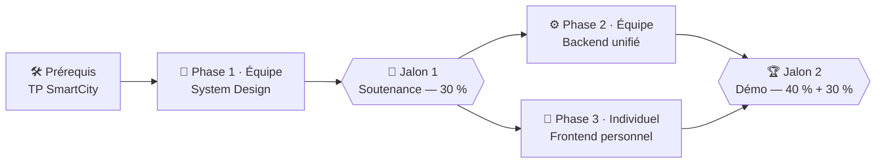

# 🚀 Projet Final — Concevoir & Développer votre Portfolio d'Ingénieur Polyglotte

> **De `SmartCity Explorer` à votre propre architecture data** : après avoir appris à structurer un backend multi-bases avec le TP guidé SmartCity, vous allez **concevoir de A à Z** l'architecture de données d'un portfolio d'ingénieur interactif, la **défendre en soutenance**, implémenter un **backend unifié en équipe**, puis créer **votre propre frontend** alimenté par vos vraies expériences et projets.

## 🎯 Pourquoi ce projet ?

1. **Un vrai travail d'architecte data** : contrairement à SmartCity où le schéma est imposé, c'est **votre équipe** qui conçoit le modèle de données, choisit comment répartir et relier les données entre MongoDB et Neo4j, et définit le contrat d'API (`API_ROUTES.md`).
2. **Un actif concret pour votre carrière** : chacun repart avec **son propre portfolio technique** (CV interactif, fiches projets, graphe de compétences), prêt à être montré pour un stage, un PFE ou un premier emploi.

## 🗺️ Organisation : 3 phases, 2 jalons

| Phase | Mode | Livrable | Évalué au | Poids |
| :--- | :---: | :--- | :---: | :---: |
| **1 — System Design** | Équipe | `ARCHITECTURE.md` + `API_ROUTES.md` + soutenance | Jalon 1 | **30 %** |
| **2 — Backend unifié** | Équipe | API FastAPI + seed avec les vraies données de tous les membres | Jalon 2 | **40 %** |
| **3 — Frontend personnel** | **Individuel** | `frontends/frontend-<pseudo>/` branché sur l'API d'équipe | Jalon 2 | **30 %** |

- **Dates et échéances** : voir le [planning officiel](../planning.md) (seule source de référence).
- **Critères et points** : voir la [grille d'évaluation](grille.md).
- **Les phases 2 et 3 se mènent en parallèle** dès la validation du Jalon 1 : c'est le contrat `API_ROUTES.md` qui permet à chacun de coder son frontend sans attendre le backend.

## 📦 Votre dépôt d'équipe

Un dépôt privé `nosql-esigelec/2026-2027-rouen-portfolio-<equipe>` est créé pour chaque équipe (mêmes équipes que SmartCity). Il contient déjà :

| Élément | Rôle | Phase |
| :--- | :--- | :---: |
| `ARCHITECTURE.md`, `API_ROUTES.md` | modèles guidés **à compléter** (plus aucun `TODO` à l'échéance) | 1 |
| `docker-compose.yml`, `justfile` | MongoDB + Neo4j sur des **ports décalés** (pas de conflit avec SmartCity), commandes `just up / seed / dev / test` | 2 |
| `backend/src/portfolio_api/` | squelette FastAPI : `core/`, `db/`, `models/`, `repositories/`, `services/`, `api/`, `scripts/seed.py` | 2 |
| `data/candidats/`, `data/projets/` | **vos vraies données**, un fichier par membre (`<pseudo>.json`) | 2 |
| `frontends/frontend-<pseudo>/` | **votre** dossier de frontend | 3 |
| `CONTRIBUTING.md` | règles de travail à plusieurs : branches, Pull Requests, qui touche quoi | toutes |

## 🧠 Phase 1 — System Design (équipe)

### 1. Le besoin produit

Un recruteur ou un Tech Lead visite votre portfolio. En moins de 60 secondes, il veut :

- consulter votre **profil** (bio, titre, liens GitHub/LinkedIn, contact) ;
- parcourir votre **frise chronologique** d'**expériences** (stages, alternance) et de **formations** ;
- explorer vos **fiches projets** (contexte, architecture, métriques, captures, liens démo/GitHub) ;
- naviguer dans votre **graphe de compétences** :
    - *« Sur quels projets et dans quelles expériences ce candidat a-t-il utilisé `Python`, `MongoDB` ou le `Machine Learning` ? »*
    - *« Quels autres projets mobilisent les mêmes compétences ? »*

### 2. Les questions d'architecture à trancher

Pour chaque entité (**Candidat, Expérience, Formation, Projet, Compétence, Domaine de compétences**), justifiez **par les requêtes** où et comment la stocker. Point de départ proposé, **à défendre ou à contester** :

| Base / pattern | Données pressenties | Questions à défendre en soutenance |
| :--- | :--- | :--- |
| **MongoDB `candidats`** — *Embedding* | Profil + tableaux imbriqués `experiences[]` et `formations[]` | Pourquoi imbriquer ? (cardinalité `1:N` **bornée**, CV lu en **une seule requête**, mises à jour rares) |
| **MongoDB `projets`** — *Referencing* | Fiches projets détaillées, reliées à leurs auteurs par `candidat_slugs[]` (un projet peut avoir plusieurs auteurs de l'équipe) | Pourquoi une collection dédiée plutôt qu'un tableau dans `candidats` ? Quel pipeline (`$match`, `$unwind`, `$group`) calcule les statistiques d'un candidat par compétence ? |
| **Neo4j** — graphe | `(:Candidat)`, `(:Projet)`, `(:Competence)`, `(:Domaine)`, `(:Entreprise)` et leurs relations | Comment modéliser `(:Competence)-[:APPARTIENT_A]->(:Domaine)` ? Quelle traversée relie les projets et les membres de l'équipe qui partagent des compétences ? |

> 💡 Support de l'atelier en salle : [Atelier design Portfolio](atelier-design.md).

## 🎤 Jalon 1 — Soutenance de System Design (30 %)

`ARCHITECTURE.md` et `API_ROUTES.md` doivent être **poussés sur `main`** avant l'échéance. Chaque équipe présente ensuite son architecture en **10 minutes** (5 min de présentation, 4 min de questions, 1 min de transition).

**`ARCHITECTURE.md`** (le modèle fourni guide chaque section) :

1. **Les requêtes à servir** (R1 à R5 et les vôtres), et la base qui répond à chacune.
2. **Modèle MongoDB** : un document d'exemple complet par collection, la justification *Embedding* / *Referencing*, les **index**, et le pipeline d'agrégation clé.
3. **Modèle Neo4j** : labels, propriétés, relations **orientées**, contraintes, et les **3 requêtes Cypher clés**.
4. **Cohérence entre les bases** : les **slugs pivots** (`candidat_slug: "alice-martin"`, `projet_slug: "smartcity-explorer"`, `skill_slug: "mongodb"`) et ce qui se passe à la suppression d'un projet.
5. **Répartition du travail** entre les membres.

**`API_ROUTES.md`** (le contrat entre le backend et les frontends) :

- toutes les routes avec leurs paramètres et un **exemple de réponse JSON complet**, par exemple :
    - `GET /api/candidats/{slug}` : profil et timeline ;
    - `GET /api/candidats/{slug}/projets` : projets d'un candidat ;
    - `GET /api/candidats/{slug}/stats` : statistiques par compétence (agrégation MongoDB) ;
    - `GET /api/graph/projets/{slug}/similaires` : projets similaires (Neo4j) ;
    - `GET /api/graph/competences/{slug}` : graphe de compétences prêt à afficher (`nodes` + `links`).

## ⚙️ Phase 2 — Backend unifié (équipe, 40 %)

En reprenant l'architecture de **SmartCity Explorer**, l'équipe complète le squelette `backend/src/portfolio_api/` :

| Dossier | À faire |
| :--- | :--- |
| `db/` | singletons de connexion asynchrones : **PyMongo Async** (`AsyncMongoClient`, recommandé) ou Motor repris de SmartCity, et le **driver Neo4j async** |
| `models/` | modèles Pydantic qui reflètent **exactement** les réponses de `API_ROUTES.md` |
| `repositories/` | une base par repository : CRUD et **agrégations** MongoDB, requêtes **Cypher** paramétrées |
| `services/` | orchestration qui croise MongoDB et Neo4j grâce aux slugs pivots |
| `api/` | routes FastAPI, documentées automatiquement dans Swagger (`http://localhost:8000/docs`) |
| `scripts/seed.py` | peuple les deux bases depuis `data/` en **une commande** (`just seed`), de façon **idempotente**, avec les **vraies données de tous les membres** |

Le `docker-compose.yml` (MongoDB + Neo4j avec `healthcheck`) est fourni : `just up` suffit.

## 🎨 Phase 3 — Frontend personnel (individuel, 30 %)

Chaque étudiant réalise **son propre frontend** dans **son** dossier `frontends/frontend-<pseudo-github>/`, branché sur l'API de l'équipe :

- **Technologie libre** : Streamlit (le plus rapide, comme SmartCity), Next.js / React (avec une librairie de graphe comme ForceGraph), Astro, Vue…
- **Vos vraies données** : votre vrai parcours (formations ESIGELEC, stages, projets académiques et personnels, compétences réelles).
- **Les trois vues attendues**, toutes alimentées par l'API (aucune donnée en dur) :
    1. **Profil & Parcours** (timeline) → MongoDB `candidats` ;
    2. **Galerie & détail des projets** → MongoDB `projets` ;
    3. **Graphe de compétences & projets similaires** → Neo4j.
- Le `README.md` de votre dossier indique la techno, **les commandes exactes pour lancer** le frontend et les routes consommées par chaque vue.

## 📊 Évaluation

| Composante | Mode | Poids (note Portfolio) |
| :--- | :---: | :---: |
| **Jalon 1 — System Design** (`ARCHITECTURE.md`, `API_ROUTES.md`, soutenance) | Équipe | **30 %** |
| **Jalon 2 — Backend unifié & seed** | Équipe | **40 %** |
| **Jalon 2 — Frontend personnel & vraies données** | **Individuel** | **30 %** |

👉 Critères et points détaillés : **[grille d'évaluation](grille.md)**.
Le TP guidé SmartCity Explorer est noté séparément (tests automatiques, voir [Évaluation](../evaluation.md#smartcity)).
