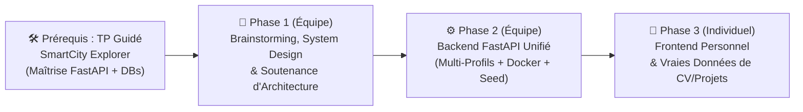

# 🚀 Projet Final — Concevoir & Développer votre Portfolio d'Ingénieur Polyglotte

> **De `SmartCity Explorer` à votre propre Architecture Data** : Après avoir appris à structurer un backend multi-bases industriel avec le TP guidé **SmartCity Explorer**, vous allez maintenant **concevoir de A à Z** l'architecture de données d'un **Portfolio d'Ingénieur interactif**, défendre vos choix en **Soutenance de System Design**, implémenter un **Backend unifié en équipe**, puis créer **votre propre Frontend individuel** alimenté par vos vraies expériences et projets.

---

## 🎯 Pourquoi ce projet ?

1. **Un vrai travail d'Architecte Data** : Contrairement à un TP à trous où le schéma est imposé, c'est **votre équipe** qui conçoit le modèle de données, choisit comment répartir et relier les données entre les bases, et définit le contrat d'API (`API_ROUTES.md`).
2. **Un actif concret pour votre carrière** : Chaque étudiant repart à la fin du module avec **son propre Portfolio technique moderne** (CV interactif, fiches projets détaillées, graphe de compétences interactif) prêt à être mis en avant pour ses recherches de stage, PFE ou premier emploi.

---

## 🗺️ Organisation en 3 Phases (Équipe + Individuel)

### 📅 Calendrier & Jalons

> 📌 **Dates, créneaux et échéances : voir le [planning officiel](../planning.md)** (seule source de référence).

- **Prérequis** : TP guidé `SmartCity Explorer` terminé (200/200).
- **Jalon 1 — System Design** : `ARCHITECTURE.md` + `API_ROUTES.md` poussés sur GitHub, puis soutenance d'équipe (30 %).
- **Jalon 2 — Démo finale** : Backend unifié d'équipe (40 %) + Frontend individuel avec vos vraies données (30 %).
- **Grille détaillée (critères et points)** : [grille d'évaluation](grille.md).

### 📦 Votre dépôt d'équipe

Un dépôt privé `nosql-esigelec/2026-2027-rouen-portfolio-<equipe>` est créé pour chaque équipe (mêmes équipes que SmartCity). Il contient déjà :
- `ARCHITECTURE.md` et `API_ROUTES.md` **à compléter** (Jalon 1) ;
- un squelette de backend FastAPI (`core/`, `db/`, `models/`, `repositories/`, `services/`, `api/`, `scripts/seed.py`) ;
- `data/candidats/` et `data/projets/` pour **vos vraies données** (1 fichier par membre) ;
- `frontends/frontend-<pseudo>/` : **votre** dossier de frontend ;
- `CONTRIBUTING.md` : règles de travail à plusieurs (branches, Pull Requests).

---

## 🧠 Phase 1 — Brainstorming & System Design (En équipe de 4 ou 5)

### 1. Le Besoin Produit
Un recruteur ou un Tech Lead visite votre portfolio. En moins de 60 secondes, il veut :
- Consulter votre **profil** (bio, titre, liens GitHub/LinkedIn, contact).
- Parcourir votre **frise chronologique (Timeline)** d'**expériences professionnelles** (stages, alternance) et de **formations académiques**.
- Explorer vos **fiches projets détaillées** (contexte, architecture technique, métriques clés, captures d'écran, extraits de code, liens démo/GitHub).
- Naviguer visuellement dans votre **graphe de compétences** :
  - *« Sur quels projets et dans quelles expériences ce candidat a-t-il utilisé `Python`, `MongoDB` ou `Machine Learning` ? »*
  - *« Quels sont les autres projets similaires (mobilisant les mêmes compétences) ? »*

### 2. Questions d'Architecture à résoudre par votre équipe

Pour chaque entité métier (**Candidat, Expérience Pro, Formation, Projet détaillé, Compétence globale, Sous-compétence**), vous devez justifier **par les patterns de requêtes** où et comment la stocker :

#### Variante A — Parcours SQL Avancé & NoSQL (Campus Poitiers : PostgreSQL + MongoDB + Neo4j)
| Base de données | Données pressenties | Questions de justification (à défendre en soutenance) |
| :--- | :--- | :--- |
| **🐘 PostgreSQL** *(Relationnel)* | **Candidats, Expériences Pro, Formations, Référentiel de Compétences** | Pourquoi le modèle relationnel est-il pertinent pour les expériences et formations ? Quelles clés étrangères et contraintes d'intégrité utilisez-vous ? |
| **🍃 MongoDB** *(Document JSON)* | **Fiches Projets riches** (descriptions longues, sections variables, métriques, galerie d'images, rapports) | Pourquoi un document JSON polymorphe est-il supérieur à des tables SQL rigides pour décrire des projets très différents (IA, Web, Électronique, Réseau) ? |
| **🕸️ Neo4j** *(Graphe)* | **Graphe de Compétences ↔ Projets ↔ Candidats** | Quels sont vos labels de nœuds (`Project`, `SubSkill`, `GlobalSkill`, `Candidate`) et vos types de relations ? Quelle requête Cypher recommande les projets similaires ? |

#### Variante B — Parcours 100 % NoSQL (Campus Rouen BDTN : MongoDB + Neo4j)
| Base / Pattern | Données pressenties | Questions de justification (à défendre en soutenance) |
| :--- | :--- | :--- |
| **🍃 MongoDB (`candidats`) — Pattern *Embedding*** | **Profil Candidat + Tableaux imbriqués `experiences[]` et `formations[]`** | Pourquoi imbriquer (*embed*) les expériences et formations directement dans le document du candidat ? (Cardinalité `1:N` bornée, lecture atomique du CV en 1 requête). |
| **🍃 MongoDB (`projets`) — Pattern *Referencing*** | **Fiches Projets détaillées** liées par `candidat_slug` + tags/métriques | Pourquoi séparer les fiches projets détaillées dans une collection dédiée plutôt que de les imbriquer dans `candidats` ? Quel pipeline d'agrégation (`$match`, `$unwind`, `$group`) permet de calculer les statistiques du candidat par technologie ? |
| **🕸️ Neo4j** *(Graphe)* | **Graphe de Compétences ↔ Projets ↔ Candidats de l'équipe** | Comment modéliser la hiérarchie `(SousCompetence)-[:BELONGS_TO]->(CompetenceGlobale)` et traverser le graphe pour relier les projets et les membres de l'équipe partageant des compétences ? |

---

## 🎤 Jalon 1 — Soutenance d'Architecture & System Design (30 % de la note)

Avant d'écrire le code métier, chaque équipe présente son architecture (10 min par équipe : 5 min de présentation + 4 min de questions + 1 min de transition) avec un document **`ARCHITECTURE.md`** et **`API_ROUTES.md`** à la racine de son dépôt GitHub contenant :
1. **Diagramme d'architecture globale** (Mermaid) montrant le rôle de l'API Orchestrateur FastAPI et des bases de données.
2. **Modèles de données détaillés** :
   - Schéma relationnel (PostgreSQL) et/ou Schéma des collections JSON (MongoDB : *Embedding* vs *Referencing*) + Index choisis.
   - Modèle du graphe Neo4j (Nœuds, Propriétés, Relations orientées).
3. **Contrat de cohérence inter-bases (Pivot / Slugs)** :
   - Comment reliez-vous un projet stocké dans MongoDB avec son nœud dans Neo4j et son auteur ? *(Conseil : utilisez des `slug` lisibles et uniques, ex. `candidat_slug: "alice-martin"`, `projet_slug: "smartcity-explorer"`, `skill_slug: "mongodb"`).*
4. **Spécification complète des routes REST (`API_ROUTES.md`)** :
   - Liste des endpoints (`GET /api/candidats/{slug}`, `GET /api/projets`, `GET /api/graph/projets/{slug}/similaires`, etc.) avec exemples de payloads JSON afin que chaque membre puisse développer son Frontend en parallèle.

---

## ⚙️ Phase 2 — Backend Unifié en Équipe (40 % de la note)

En vous inspirant directement de la structure industrielle de **`SmartCity Explorer`**, votre équipe implémente dans le dépôt d'équipe :
- `docker-compose.yml` : Conteneurs des bases de données avec `healthcheck`.
- `backend/db/` : Singletons de connexion asynchrones (`PyMongo Async` ou `Motor` repris de SmartCity, `Neo4j AsyncDriver`).
- `backend/models/` : Modèles Pydantic de validation des entrées/sorties.
- `backend/repositories/` : Requêtes isolées par base de données (SQL, MongoDB CRUD + Agrégation, Cypher Neo4j).
- `backend/services/` : Service orchestrateur capable d'interroger et de croiser les bases de données.
- `backend/api/` : Routes FastAPI documentées dans Swagger UI (`http://localhost:8000/docs`).
- `backend/scripts/seed_*.py` & `database/*/seed.json` : Scripts d'initialisation permettant de peupler les bases en une seule commande avec **les vrais profils et projets de tous les membres de l'équipe**.

---

## 🎨 Phase 3 — Frontend Individuel & Vraies Données (30 % de la note)

Chaque étudiant de l'équipe réalise **son propre Frontend** (dans **son** dossier `frontends/frontend-<pseudo-github>/` du dépôt d'équipe) qui consomme l'API FastAPI du groupe :
- **Liberté technologique totale sur le Front** : Next.js / React (avec Tailwind, Three.js / ForceGraph pour le graphe de compétences), Astro, Vue, ou Streamlit.
- **Vraies données personnelles** : Votre portfolio doit afficher **votre vrai CV** (formations ESIGELEC, stages, projets académiques et personnels, compétences réelles).
- **Exploitation visible des bases** :
  1. Page **Profil & Parcours (Timeline)** alimentée par PostgreSQL (ou MongoDB `candidats`).
  2. Page **Galerie & Détail des Projets** alimentée par MongoDB `projets`.
  3. Page ou composant interactif **Graphe de Compétences & Recommandations « Projets similaires »** alimenté par Neo4j.

---

## 📊 Évaluation

| Composante | Mode | Poids (note Portfolio) |
| :--- | :---: | :---: |
| **Jalon 1 — System Design** (`ARCHITECTURE.md`, `API_ROUTES.md`, soutenance) | Équipe | **30 %** |
| **Jalon 2 — Backend unifié & Seed** | Équipe | **40 %** |
| **Jalon 2 — Frontend personnel & vraies données** | **Individuel** | **30 %** |

👉 Critères et points détaillés : **[grille d'évaluation](grille.md)**.
Le TP guidé `SmartCity Explorer` est noté séparément (tests automatiques, voir [Évaluation](../evaluation.md#smartcity)).
